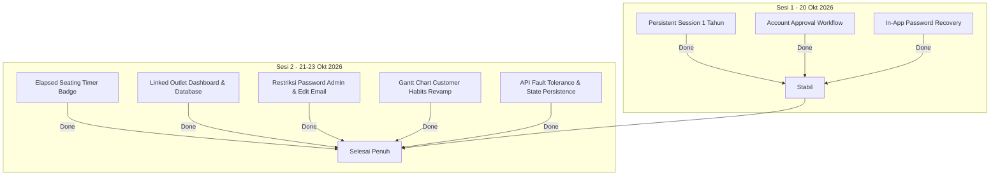

# LAPORAN LANJUTAN PENGEMBANGAN SISTEM & TINDAK LANJUT OPERASIONAL (TAHAP II)
**Sistem Manajemen Meja & Restoran (Meja-O)**

---

**Kepada Yth.** : Person in Charge (PIC) / Manajemen Operasional  
**Dari** : Tim Pengembang Meja-O  
**Tanggal Laporan** : 23 Oktober 2026  
**Dokumen Acuan** : Melanjutkan [Laporan Feedback Operasional Outlet Kupang Indah (20 Oktober 2026)](file:///C:/Users/LEGION/.gemini/antigravity/brain/31e46e94-6d99-4ddd-b8b3-221f397c8765/laporan_feedback_outlet_kupang_indah.md)  
**Perihal** : Rekapitulasi Penyelesaian Poin Tertunda (Elapsed Timer) serta Implementasi Pembaruan Lanjutan pada Dashboard, Database, Profil, dan Hak Akses Pengguna  

---

### I. RINGKASAN EKSEKUTIF

Laporan ini merupakan kelanjutan resmi dari **Laporan Implementasi Feedback Operasional tanggal 20 Oktober 2026**. Pada periode 21 hingga 23 Oktober 2026, seluruh sisa antrean pengembangan teknis—khususnya indikator durasi duduk (*Elapsed Seating Timer*) pada denah meja—telah **berhasil diselesaikan 100% dan teruji dengan baik**.

Selain menuntaskan poin tertunda tersebut, tim pengembang juga telah mengimplementasikan serangkaian peningkatan substansial yang mencakup:
1. **Peningkatan Visibilitas Denah Lantai (Dashboard)**: Integrasi lencana durasi waktu duduk real-time di tiap meja.
2. **Sinkronisasi Navigasi Terpadu**: Integrasi pemilihan outlet antar-halaman (*linked outlet selector*) untuk memudahkan mobilitas kerja Super Admin.
3. **Penguatan Keamanan & Privasi Akun**: Fleksibilitas pembaruan email pengguna serta pembatasan izin lihat kata sandi (*Current Password permission*) khusus bagi Super Admin.
4. **Revamp Tampilan Database & Gantt Chart Kebiasaan Tamu (*Customer Habits*)**: Perombakan desain grafik Gantt menjadi lebih ringkas (*compact*), pembekuan kolom kiri dan header waktu (*sticky frozen headers*), pelabelan durasi cerdas, serta penanganan koneksi API hari libur yang tangguh.
5. **Persistensi State & Navigasi Cerdas**: Penyimpanan memori posisi filter/halaman pengguna saat berpindah menu, serta reset otomatis preferensi baris data saat keluar (*logout*).

---

### II. MATRIKS STATUS PERKEMBANGAN FITUR

| No | Modul / Fitur | Kategori | Status Saat Ini | Dampak & Nilai Tambah Operasional |
| :---: | :--- | :--- | :---: | :--- |
| **1** | **Indikator Waktu Duduk Meja di Dashboard** (*Elapsed Seating Timer*) | Visibilitas Frontline | SELESAI (DONE) | Staf dapat langsung memantau durasi duduk tamu (`15m`, `1h 10m`) tanpa perlu membuka popup detail meja. |
| **2** | **Sinkronisasi Pemilihan Outlet Antar Menu** (*Dashboard–Database Linked State*) | Efisiensi Navigasi | SELESAI (DONE) | Super Admin tidak perlu memilih ulang outlet ketika berpindah antara denah meja dan basis data laporan. |
| **3** | **Pembaruan Alamat Email Mandiri** (*Account Email Updatable*) | Manajemen Profil | SELESAI (DONE) | Alamat email staf/admin dapat disunting mandiri, sementara entitas Brand/Outlet tetap terkunci aman. |
| **4** | **Restriksi Izin Lihat Kata Sandi** (*Current Password Permission Hardening*) | Keamanan Akses | SELESAI (DONE) | Izin dinonaktifkan secara *default* bagi Admin, menjaga kerahasiaan kredensial yang hanya dapat dilihat Super Admin. |
| **5** | **Filter Tahun/Tanggal Laporan Keseluruhan** (*Overall Date Filter*) | Analisis Data | SELESAI (DONE) | Memungkinkan peninjauan perbandingan tren performa antar-tahun pada tab Overall. |
| **6** | **Penyederhanaan Nomenklatur Tamu** (*Guest Label Optimization*) | Standarisasi UI | SELESAI (DONE) | Mengubah sebutan panjang *"Walk-In-Guest"* menjadi *"Guest"* agar tabel lebih rapi dan ringkas. |
| **7** | **Restrukturisasi Gantt Chart Kebiasaan Tamu** (*Customer Habits UI Revamp*) | Visualisasi Data | SELESAI (DONE) | Header diagonal `GUEST \ TIME`, panel kiri & atas terkunci (*sticky*), baris ramping, dan teks durasi cerdas. |
| **8** | **Proteksi Gangguan API Hari Libur Nasional** (*Holiday API Resiliency*) | Stabilitas Sistem | SELESAI (DONE) | Sistem kebal terhadap kendala jaringan eksternal (*connection reset*) melalui *graceful fallback* & *caching*. |
| **9** | **Persistensi State Navigasi & Pemisahan Baris Halaman** (*Page Memory & Per-Tab Rows*) | Kenyamanan Pengguna | SELESAI (DONE) | Sistem mengingat tab dan halaman terakhir saat berpindah menu; pengaturan baris per tab terisolasi mandiri. |
| **10**| **Pembersihan Otomatis Saat Keluar** (*Session Reset on Logout*) | Standarisasi Privasi | SELESAI (DONE) | Tampilan baris data kembali ke default (5 baris) saat pengguna keluar demi keseragaman tampilan awal. |

---

### III. RINCIAN TEKNIS IMPLEMENTASI PEMBARUAN

#### 1. Penuntasan Indikator Waktu Duduk Meja di Dashboard (*Elapsed Seating Timer Badge*) — **STATUS: DONE**
* **Implementasi:**
  - Ditambahkan lencana waktu dinamis di atas unit meja yang sedang berstatus terisi (*Occupied*).
  - Durasi dihitung secara langsung berdasarkan `seated_at` dengan format yang ringkas dan mudah dibaca secara sekilas (contoh: `15m`, `45m`, `1h 20m`).
  - Tampilan dirancang kontras dan adaptif untuk perangkat mobile maupun layar desktop, membantu *floor captain* dan pelayan mengantisipasi *turnover* meja lebih dini.

---

#### 2. Keterhubungan Pemilihan Outlet (*Linked Outlet Navigation*) — **STATUS: DONE**
* **Latar Belakang:**  
  Super Admin yang mengawasi banyak cabang sering memeriksa status denah lantai (misal: *Ah Pek Kupang Indah*), kemudian beralih ke menu Database. Sebelumnya, halaman Database me-reset pilihan cabang ke outlet pertama dalam daftar (*Bendungan Hilir*), sehingga menyulitkan evaluasi terpadu.
* **Solusi & Implementasi:**
  - Mengintegrasikan mekanisme sinkronisasi *state* berbasis *session/parameter* antara `dashboard.blade.php` dan `database.blade.php`.
  - Ketika Super Admin beralih dari denah meja ke menu laporan database (atau sebaliknya), sistem mempertahankan cabang aktif yang sedang ditinjau tanpa perlu memilih ulang secara manual.

---

#### 3. Fleksibilitas Profil & Penguatan Hak Akses Kredensial — **STATUS: DONE**
* **Pembaruan Informasi Akun Pengguna:**
  - Field **Email Address** pada menu Profile kini dapat diperbarui secara mandiri oleh pemilik akun bersama dengan Nama Lengkap (*Full Name*).
  - Field **Assigned Brand / Outlet** tetap dikunci (*read-only*) guna mencegah ketidaksesuaian penempatan staf.
* **Privasi Kata Sandi (*Permission Hardening*):**
  - Izin `prof_col_password` ("Current Password") dinonaktifkan secara *default* pada profil hak akses tingkat Administrator.
  - Hanya peran **Super Admin** yang memiliki otorisasi penuh untuk meninjau kata sandi pengguna secara langsung, mencegah potensi penyalahgunaan wewenang antar-staf internal.

---

#### 4. Transformasi Tampilan Grafik Gantt Kebiasaan Tamu (*Customer Habits*) — **STATUS: DONE**
Modul laporan pola kebiasaan pelanggan (*Customer Habit*) pada menu Database mendapatkan perombakan tampilan menyeluruh guna mendukung analisis data bervolume tinggi:
* **Header Sel Diagonal Presisi (`GUEST \ TIME`):**  
  Menghilangkan header bertingkat yang memakan ruang. Sudut kiri atas tabel kini menggunakan pemisah diagonal (*split cell*) yang memposisikan label `GUEST` di kiri-bawah dan `TIME` di kanan-atas secara proporsional.
* **Pembekuan Header Vertikal & Horizontal (*Frozen Sticky Headers*):**  
  - Kolom identitas tamu di sisi kiri tetap terkunci (*fixed sticky*) saat grafik digeser ke kanan untuk melihat jam malam.
  - Baris penunjuk waktu (00:00 – 24:00) tetap terkunci di bagian atas saat daftar tamu digulir ke bawah (*vertical scroll*).
* **Tata Letak Ramping & Rata Kiri (*Compact & Left-Aligned Layout*):**  
  Menghapus kata berulang *"TABLE"* pada baris data, merampingkan lebar baris/kolom, serta meratakan nomor meja dan nama tamu ke sisi kiri dengan tipografi berwarna hitam tegas agar mudah dibaca.
* **Penempatan Durasi Bar Cerdas (*Smart Label Placement*):**  
  - Tamu dengan durasi duduk > 1 jam menampilkan teks durasi di dalam batang (*inside bar*).
  - Tamu dengan durasi singkat (< 1 jam) secara otomatis menampilkan teks durasi di sebelah kanan luar batang (*outside adjacent*) agar tidak tertutup.
  - Dilengkapi logika pendeteksi batas tepi: apabila batang berada di ujung akhir timeline (mendekati 24:00), teks durasi otomatis bergeser ke sebelah kiri batang agar tidak terpotong tepi layar.
* **Perbaikan Visual Timeline 00:00:**  
  Menyesuaikan margin dan penanganan overflow agar penanda waktu awal `00:00` tidak lagi terpotong menjadi `:00`.

---

#### 5. Keandalan Sistem & Ketahanan API Hari Libur (*Fault-Tolerant Integration*) — **STATUS: DONE**
* **Kendala Sebelumnya:**  
  Saat server penyedia data kalender nasional eksternal mengalami gangguan koneksi (*cURL error 35: Recv failure / connection reset*), halaman laporan database mengalami *Internal Server Error (500)*.
* **Solusi Teknis:**  
  - Mengimplementasikan blok pengaman (*try-catch exception handling*) dengan *graceful fallback* pada `ReportController.php`.
  - Menerapkan *caching* 24 jam untuk data hari libur nasional. Apabila jaringan eksternal terputus atau gagal merespons, sistem tetap menyajikan laporan tanpa interupsi dan tanpa merusak alur kerja pengguna.

---

#### 6. Navigasi Memori (*State Persistence*) & Standarisasi Logout — **STATUS: DONE**
* **Penyimpanan State Halaman (*Smart Position Memory*):**  
  Pengguna yang sedang menganalisis data pada tab tertentu (misal: *Customer Habits*, halaman ke-4, filter tanggal spesifik) dapat berpindah ke menu lain (seperti Dashboard) dan kembali ke menu Database tanpa kehilangan posisi terakhir.
* **Isolasi Konfigurasi Baris Per Halaman (*Independent Rows per Page*):**  
  Setiap sub-kategori laporan (Overall, Daily, Weekly, Monthly, Yearly, Waitlist, Customer Habits) memiliki pengaturan baris per halaman (*rows per page*) yang berdiri sendiri dan tidak saling menimpa.
* **Pembersihan Standar Saat Keluar (*Clean Logout Reset*):**  
  Saat staf atau admin melakukan *logout*, preferensi jumlah baris per halaman otomatis dikembalikan ke standar awal (**5 baris**) pada seluruh modul (Database, Profile, Account Management). Hal ini menjamin bahwa setiap sesi kerja baru dimulai dengan tata letak yang seragam dan ringan dimuat.

---

### IV. REKAPITULASI STATUS AKHIR (SELURUH POIN SELESAI)

Seluruh 4 (empat) butir masukan awal dari operasional outlet Kupang Indah beserta 6 (enam) butir pembaruan lanjutan yang diajukan selama tahap pengujian kini telah **berstatus 100% Selesai (Done)** dan aktif pada instalasi aplikasi.

---

### V. KESIMPULAN & REKOMENDASI TAHAP BERIKUTNYA

Dengan diselesaikannya implementasi pada laporan lanjutan ini:
1. **Operasional Frontline** memiliki visibilitas denah meja yang sangat intuitif dengan hadirnya indikator durasi duduk real-time.
2. **Manajemen / Super Admin** mendapatkan efisiensi mobilitas tinggi berkat sinkronisasi pemilihan outlet serta kemampuan analisis data visual melalui Gantt Chart yang responsif.
3. **Stabilitas & Keamanan Sistem** telah ditingkatkan melalui restriksi hak akses kredensial, proteksi jaringan API eksternal, dan manajemen sesi yang bersih.

Sistem Meja-O dinyatakan siap untuk digunakan sepenuhnya dalam operasional harian outlet.

---
*Laporan lanjutan ini disusun secara resmi sebagai kelanjutan dokumentasi proyek Meja-O.*
